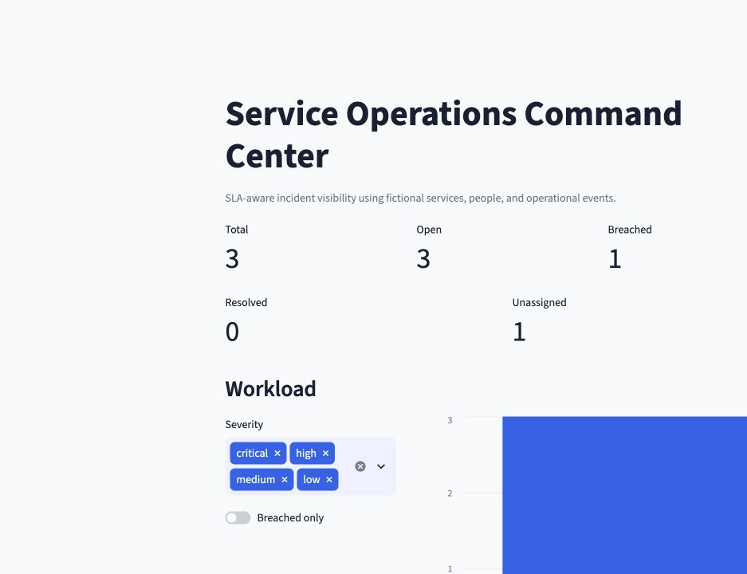
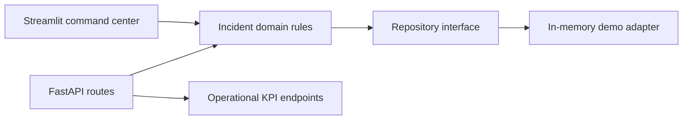

# Service Operations Command Center

[](https://github.com/alianisreyesr/service-operations-command-center/actions/workflows/ci.yml)
[](https://github.com/alianisreyesr/service-operations-command-center/actions/workflows/codeql.yml)


**Backend Engineering · SaaS Operations · SLA Management · API Design**

A portfolio-safe service operations API for incident intake, prioritization, ownership, lifecycle control, and SLA visibility.

[API demo](#quick-start) · [Case study](docs/CASE_STUDY.md) · [Architecture](docs/ARCHITECTURE.md) · [Source](https://github.com/alianisreyesr/service-operations-command-center)

> **Data boundary:** The bundled organizations, users, and incidents are fictional. The application is a portfolio prototype, not a production ticketing or emergency-response system.

## Portfolio preview



The dashboard is rendered from the same domain metrics and priority rules exposed by the API (shared code, not HTTP calls; see [Dashboard and API](#dashboard-and-api)).

## Business outcome

Support and technology teams need a consistent operational picture: what is open, what is overdue, who owns it, and which service commitments are at risk. This API turns those questions into explicit domain rules and measurable endpoints.

## Capabilities

- Incident intake with severity-based SLA targets
- Controlled status transitions and owner assignment
- Priority queue ordered by breach state, severity, and due time
- Portfolio-safe actor attribution on mutations
- Reverse-chronological audit events for creation, assignment, and status changes
- Operational metrics for open, breached, resolved, and unassigned work
- Interactive Python/Streamlit command center, OpenAPI documentation, container packaging, and automated tests

## Architecture



The repository boundary is intentionally explicit so a PostgreSQL adapter can replace the demonstration store without moving business rules into HTTP handlers.

## Quick start

```bash
python -m venv .venv
source .venv/bin/activate
python -m pip install -r requirements-dev.txt   # runtime + pytest, httpx, ruff, mypy
uvicorn app.main:app --reload
streamlit run dashboard.py
```

Open the Streamlit command center at `http://127.0.0.1:8501`, the compact FastAPI view at `http://127.0.0.1:8000/`, or the [OpenAPI documentation](http://127.0.0.1:8000/docs). You can also run:

```bash
curl http://127.0.0.1:8000/api/metrics
curl http://127.0.0.1:8000/api/incidents/priority-queue
python -m pytest --cov
ruff check . && mypy
```

Docker:

```bash
docker build -t service-operations-command-center .
docker run --rm -p 8000:8000 service-operations-command-center
# or both services (API on 8000, dashboard on 8501):
docker compose up --build
```

### Dashboard and API

The Streamlit dashboard and the FastAPI service are two independent processes that share the same domain and repository *code*. The dashboard imports `app.main` and reads its own in-memory repository; it does not call the HTTP API. Incidents created through the API (for example with `curl`) therefore do not appear in the dashboard, and vice versa, and `docker compose` runs them as separate containers with separate state. Pointing the dashboard at the API would be the first step of the PostgreSQL roadmap, when both share one store.

### Lifecycle rules

`open -> investigating -> mitigated | resolved`, and `mitigated -> investigating | resolved`. `resolved` is terminal: an incident cannot be reopened or reassigned. Anything else returns `409`.

## API surface

| Method | Endpoint | Purpose |
|---|---|---|
| GET | `/health` | Runtime health and portfolio boundary |
| GET | `/` | Compact HTML view of the metrics and priority queue |
| GET/POST | `/api/incidents` | List (paginated: `limit` 1-200, default 50, `offset`; total in `X-Total-Count`) or create incidents |
| GET | `/api/incidents/priority-queue` | Decision-ready work queue |
| PATCH | `/api/incidents/{id}/status` | Controlled lifecycle transition |
| PATCH | `/api/incidents/{id}/owner` | Attributable owner assignment |
| GET | `/api/metrics` | SLA and workload metrics |
| GET | `/api/audit-events` | Reviewable mutation history (newest first; only the latest 1000 events are kept) |

## Engineering boundary

Authentication is represented by the `X-Actor` header for attributable demo actions; it is not identity verification. Production use would require OIDC, RBAC enforcement, PostgreSQL migrations, background workers, notifications, rate limits, secrets management, observability, tenancy isolation, and recovery controls.

## Target roles

Backend Engineer · Full-Stack Engineer · Software Engineer · Platform Engineer

## Portfolio Ecosystem

Related portfolio projects (synthetic data only):

| Project | Domain Focus | Status |
|---|---|---|
| **[Quality Deviation Risk Monitor](https://github.com/alianisreyesr/quality-deviation-risk-monitor)** | Deviation prioritization & explainable risk scoring | ✅ Active |
| **[CSV Evidence Tracker](https://github.com/alianisreyesr/csv-evidence-tracker)** | Requirements traceability, IQ/OQ/PQ test execution, audit trail | ✅ Active |
| **[GxP Change Control](https://github.com/alianisreyesr/gxp-change-control)** | Controlled change lifecycle & approvals | ✅ Active |
| **[Data Integrity Case File](https://github.com/alianisreyesr/data-integrity-case-file)** | ALCOA+ investigation, CAPA readiness, local AI triage | ✅ Active |
| **[CSA Assurance Planner](https://github.com/alianisreyesr/csa-assurance-planner)** | Risk-based software assurance planning, FDA CSA alignment | ✅ Active |
| **[GxP Batch Data Pipeline](https://github.com/alianisreyesr/gxp-batch-data-pipeline)** | Batch manufacturing pipeline — DuckDB · dbt · quality gates | ✅ Active |
| **[AI Security Analyst](https://github.com/alianisreyesr/ai-security-analyst)** | Deterministic log detection, MITRE ATT&CK mapping, bounded AI summaries | ✅ Active |
| **[Retail Operations Data Platform](https://github.com/alianisreyesr/retail-operations-data-platform)** | DuckDB analytics pipeline with tested quality gates | ✅ Active |
| **[AI Document Intelligence Evaluator](https://github.com/alianisreyesr/ai-document-intelligence-evaluator)** | RAG and AI evaluation: citations, recall@k, groundedness | ✅ Active |

---

Built by [Alianis Reyes-Reyes](https://www.linkedin.com/in/alianis-reyes-reyes/).
