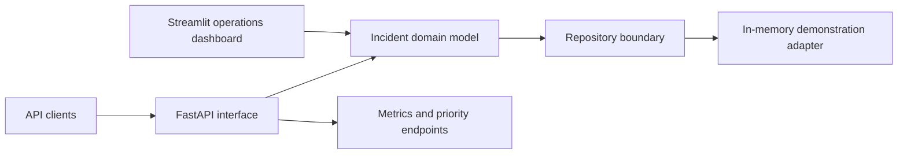
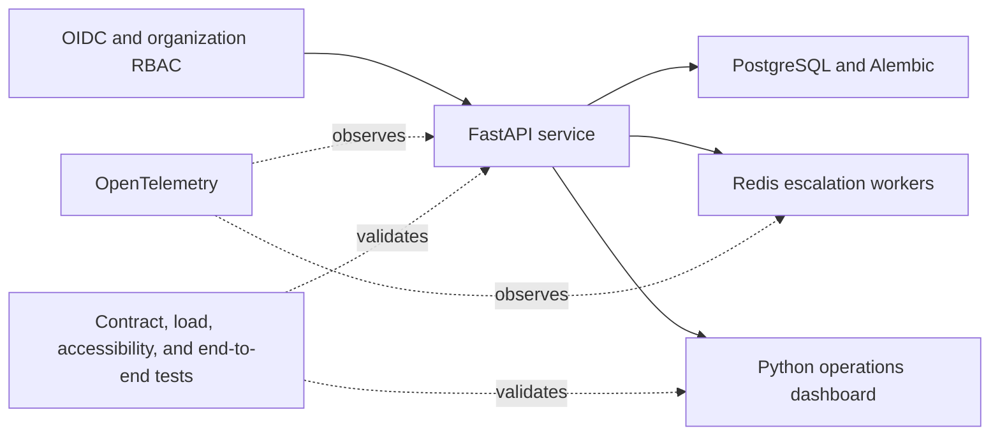

# Architecture

The Streamlit dashboard and the API are separate processes that import the same code. The dashboard does not call the HTTP endpoints, and each process holds its own in-memory store, so their data is not shared until a common persistent adapter (PostgreSQL) exists.

Operational notes: time is read through an injectable `clock` in `app/main.py` (tests use a fixed clock); the audit log is a bounded deque (1000 events); incident ids are `INC-` plus 12 hex characters; the priority queue breaks ties by `created_at` and then `id`, so its order is deterministic.

## Layers

1. **HTTP interface:** FastAPI request validation, response models, and status semantics.
2. **Domain:** incident creation, SLA targets, and permitted transitions.
3. **Repository adapter:** in-memory demonstration store, replaceable by PostgreSQL.
4. **Decision endpoints:** priority queue and operational metrics.

## Production roadmap

